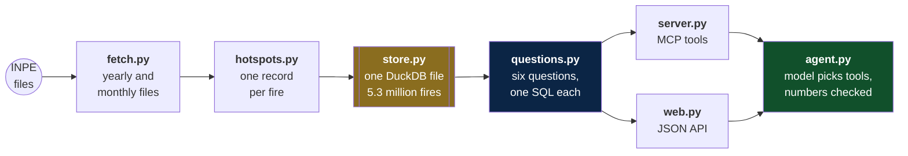

# Fire MCP

Imagine you work for a farm cooperative, an insurer or a newsroom in
Brazil. Every dry season somebody asks the same things: how much burned
near us, is it worse than last year, which towns are the worst. The
answers are public, in INPE's fire database, but getting them means
clicking through filters and downloading files.

**This project lets any AI assistant answer those questions, with
numbers that match INPE's own.**

It is an MCP server: a small program that hands an AI assistant a set
of tools. Here the tools count fires by place and date, rank cities,
draw a daily line, compare two periods, search around a point, and
return points for a map. Every number comes from a database built from
INPE's files. The AI only chooses the tool and writes the sentence.

## The shape of it



## The one rule

The model never produces a number. It picks a tool and copies the
number the tool returned. Code then checks every number in its
sentence against the tool results. One that matches nothing throws the
sentence away, and code says what the tool found instead.

## Checked against INPE

Counted from INPE's files and compared with INPE's statistics page on
2026-10-11:

| Area | INPE | This project |
|---|---|---|
| Brazil, every year 2003 to 2025 | 23 totals | all 23 equal |
| Brazil, January to September 2026 | 9 totals | all 9 equal |
| Goias, September 2026 | 431 | 431 |

## Thirty questions, asked for real

The agent answered thirty written questions, in Portuguese and English,
through the MCP server with DeepSeek. The expected numbers came from
INPE's statistics page, or from SQL written apart from the tools.

| | |
|---|---|
| Passed | 30 of 30 (the bar was 28) |
| Average time | 2.7 seconds |
| Sentences thrown away by the guard | 0 |

One question asked about "Goiaz". The tool refused the spelling and
suggested GOIAS; the model asked again and got the right number. One
asked for hectares burned. The model said hotspots cannot measure area.
Every answer is in [`eval/results.json`](eval/results.json).

## Five minutes

```bash
pip install -r requirements.txt

python -m pytest          # 139 tests, no network
python load.py            # INPE's files, about six minutes
python ask.py "Quantos focos em Goias em setembro de 2026?"
```

The last line needs a DeepSeek key:
[connect the key](docs/how-to.md#connect-the-deepseek-key).

## The files

```
load.py             fill or refresh the database
serve.py            the MCP server, over stdio
run_api.py          the JSON API, on port 8001
ask.py              one question from the command line
run_eval.py         the thirty questions, scored

src/
  the data
    hotspots.py     INPE's two file shapes, read into one record
    fetch.py        which files to download, and loading them
    store.py        the DuckDB file

  the questions
    places.py       Goias, goias and GO are the same state
    questions.py    the six questions, one SQL each
    provenance.py   source, days held, and warnings
    replies.py      the answer shape both doors hand out

  the doors
    server.py       the MCP tools
    web.py          the JSON API
    agent.py        the model, the tools, and the number guard
    model.py        the only file that knows DeepSeek exists
    scoring.py      marking an answer against the golden set

eval/               the thirty questions and the last run
tests/              139 tests
```

## The documents

| # | Document | Read it when |
|---|---|---|
| 1 | [Tutorial](docs/tutorial.md) | you have never run this and want one answer, end to end |
| 2 | [Explanation](docs/explanation.md) | you want to know why it is built this way |
| 3 | [Reference](docs/reference.md) | you need a tool, a route, or a module |
| 4 | [How-to guide](docs/how-to.md) | you know it already and need a recipe |

## What this is not

It does not measure area burned, and it does not say who lit a fire.
A hotspot is a hot pixel about one kilometre wide, seen by one
satellite once a day. The limits are written out for the model too, as
the MCP resource `fires://about`. There is no dashboard yet: the API it
will read is ready.
